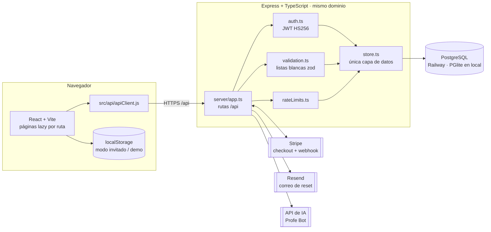

# ApoyandoTec

Plataforma educativa para estudiantes del **Instituto Tecnológico de Saltillo (ITS)**: teoría, simuladores interactivos y exámenes de práctica para las materias del tronco común de ingeniería.

> Proyecto estudiantil independiente; no es un sitio oficial del TecNM.

## Qué hace

| Módulo | Ruta | Para qué sirve |
|---|---|---|
| Dashboard | `/` | Avance por materia, racha diaria, reto del día y métricas. |
| Materias | `/materia/:id` | Temario, teoría, ejemplos resueltos y ejercicios con revisión paso a paso. |
| Laboratorio | `/laboratorio` | Simuladores 2D/3D: armaduras, engranes, motor, rotación, oscilador, graficador, redes/Simplex. |
| Examen | `/examen` | Simulador de examen parcial cronometrado, con calculadora y formulario. |
| Diagnóstico | `/diagnostico` | Evaluación inicial (álgebra, trigonometría, geometría, cálculo y física) con una ruta recomendada. |
| Cátedra | `/catedra` | Tips y plantillas que comparten los estudiantes sobre cada materia y profesor. |
| Profe Bot | `/tutor` | Tutor IA con el contexto del ejercicio o simulador (en modo simulado si no hay `AI_API_KEY`). |
| Asesores | `/asesores` | Directorio de asesores estudiantes; se agenda y paga una sesión con Stripe. |
| Formulario | `/formulario` | Fórmulas clave por materia. |

**Materias:** Cálculo Diferencial, Integral y Vectorial, Álgebra Lineal, Ecuaciones Diferenciales, Métodos Numéricos, Probabilidad y Estadística, Investigación de Operaciones, Fundamentos de Programación, Contabilidad de Costos e Ingeniería Económica, Física General / Dinámica, Electricidad y Magnetismo, Termodinámica, Estática y Dinámica de Estructuras, Química General y Propiedades de los Materiales.

**Progreso:** XP y nivel, racha con protectores, créditos 3D diarios y plan Premium (Stripe). Se puede **explorar sin cuenta** (el avance se guarda en el navegador) o entrar con la **cuenta demo**.

## Arquitectura



- **Frontend** (`src/`): React 18, React Router, TanStack Query, Tailwind + shadcn/ui, Three.js para los simuladores 3D y KaTeX para las fórmulas. Cada página se descarga cuando se visita.
- **Contenido** (`src/data/`): materias, bancos de exámenes y diagnóstico, y fórmulas están en el código, sin base de datos. El reto del día sale de una semilla por fecha, así que es el mismo para todo el ITS.
- **API** (`server/`): Express sirve `/api` y el frontend compilado. El cliente solo pide acciones; XP, precios, suscripción y estados los decide el servidor.
- **Datos**: PostgreSQL. `server/schema.sql` define las tablas (se aplica sola al arrancar), `server/db.ts` conecta con `pg` si hay `DATABASE_URL` o con **PGlite** (Postgres embebido, sin instalar nada) en desarrollo y pruebas, y `server/store.ts` es la única puerta a los datos. Las reglas que leen y escriben (XP, créditos, reservas, pagos) corren en transacciones con `SELECT … FOR UPDATE`.
- **Reglas compartidas**: `src/lib/streakRules.ts` se usa en el navegador (modo invitado) y en el servidor, para que la racha se calcule igual en los dos lados.

### Estructura
```
NexxusTech/
├─ server/            API Express + TypeScript
│  ├─ app.ts          rutas (auth, functions/*, entities/*, Stripe)
│  ├─ config.ts       variables de entorno validadas con zod
│  ├─ auth.ts · rateLimits.ts · validation.ts
│  ├─ schema.sql      tablas de PostgreSQL
│  ├─ db.ts           conexión (pg en producción, PGlite en local)
│  ├─ store.ts        acceso a datos y reglas de negocio
│  ├─ stripeService.ts · mailer.ts · pricing.ts
│  └─ tests/          pruebas de seguridad y racha (node:test)
├─ src/               Frontend React
│  ├─ api/apiClient.js   único punto de contacto con la API
│  ├─ pages/          una por ruta
│  ├─ components/     ui/ (shadcn), sims/, exam/, subject/, dashboard/, monetization/…
│  ├─ data/           contenido académico
│  └─ lib/ · hooks/
├─ public/            manifest, íconos PWA
└─ vite.config.js     alias "@" → src/
```

## Requisitos
- Node.js 20 o superior · npm

## Desarrollo local
1. `cp .env.example .env` y define `JWT_SECRET` (mín. 32 caracteres):
   `node -e "console.log(require('crypto').randomBytes(48).toString('hex'))"`
   (en desarrollo, si falta, se usa un secreto aleatorio temporal y las sesiones se pierden al reiniciar).
2. `npm install`
3. `npm run dev:server` (API en :3000) y, en otra terminal, `npm run dev` (Vite en :5173).
4. Los datos locales viven en `./data/pg` (PGlite). Para usar un Postgres real, define `DATABASE_URL`.
5. En desarrollo el enlace de "Olvidé mi contraseña" se imprime en la **consola del servidor** (nunca en la respuesta HTTP).

## Pruebas y verificación
```bash
npm run test:server       # 32 pruebas (JWT, mass-assignment, reservas, rate limit, Stripe, racha…)
npm run typecheck:server  # tipos del backend
npm run typecheck         # frontend (checkJs por archivo con // @ts-check)
npm run check             # todo lo anterior + lint + build
```

## Despliegue (Railway / Render / Fly)
El servidor Express sirve el frontend compilado y la API en el **mismo dominio**; no hace falta `VITE_API_BASE_URL`.

1. **Base de datos**: agrega un servicio PostgreSQL al proyecto (en Railway: *New → Database → PostgreSQL*).
2. Variables de entorno (ver `.env.example`):
   | Variable | Obligatoria | Nota |
   |---|---|---|
   | `JWT_SECRET` | ✅ | ≥ 32 caracteres aleatorios. Sin ella el servidor **no arranca**. |
   | `APP_URL` | ✅ | `https://tu-dominio.com` (enlaces de correo, Stripe y CORS). |
   | `DATABASE_URL` | ✅ | En Railway: `${{Postgres.DATABASE_URL}}` (referencia al servicio). |
   | `TRUST_PROXY` | — | `1` por defecto en producción (necesario para el rate limit detrás del proxy). |
   | `STRIPE_SECRET_KEY`, `STRIPE_WEBHOOK_SECRET`, `STRIPE_PRICE_MONTHLY`, `STRIPE_PRICE_ANNUAL` | si usas pagos | Con Stripe activo en producción, las tres últimas son obligatorias. |
   | `RESEND_API_KEY`, `MAIL_FROM` | para restablecer contraseña | Sin proveedor, `/forgot-password` responde 503. |
   | `AI_API_KEY`, `AI_API_URL`, `AI_MODEL` | — | Sin llave, Profe Bot responde en modo simulado. |
3. Build y arranque: `npm ci && npm run build` → `npm start` (`NODE_ENV=production` ya está en el script; cualquier valor distinto de `development`/`test` se trata como producción).
4. Healthcheck: `GET /api/health`.

### Webhook de Stripe (necesario para que cancelar quite Premium)
En el Dashboard de Stripe → *Developers → Webhooks → Add endpoint*:
- URL: `https://tu-dominio.com/api/stripe/webhook`
- Eventos: `checkout.session.completed`, `checkout.session.async_payment_succeeded`,
  `customer.subscription.created`, `customer.subscription.updated`, `customer.subscription.deleted`
- Copia el *Signing secret* (`whsec_…`) a `STRIPE_WEBHOOK_SECRET`.

Prueba local: `stripe listen --forward-to localhost:3000/api/stripe/webhook`.

## Modelo de seguridad (resumen)
- **El cliente nunca fija XP, nivel, créditos, suscripción, `is_tutor`, precios ni estados.** `PATCH /api/auth/me` solo acepta `full_name`; lo demás cambia por reglas del servidor (`/functions/awardXp`, `/consume3DCredit`, Stripe, creación de `TutorProfile`).
- Cada entidad tiene una **lista blanca** de campos (`server/validation.ts`); lo demás se descarta.
- Las reservas calculan el precio y la comisión en el servidor a partir de la tarifa del asesor, y quedan inmutables al pagarse.
- JWT HS256 con `iss`/`aud`/`exp` y versión de credenciales: cambiar la contraseña revoca todas las sesiones.
- Rate limiting por IP, por cuenta y por usuario; webhook con firma verificada e idempotente.
- Con más de una instancia, el rate limit (en memoria) debe pasar a un store compartido (Redis o Postgres).
